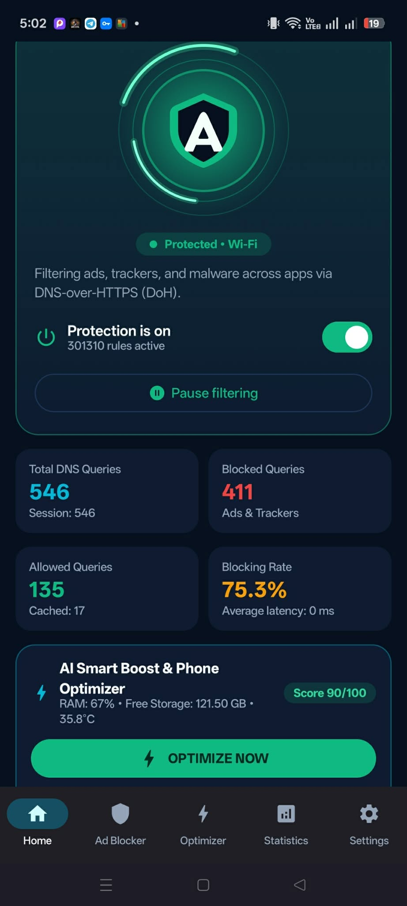
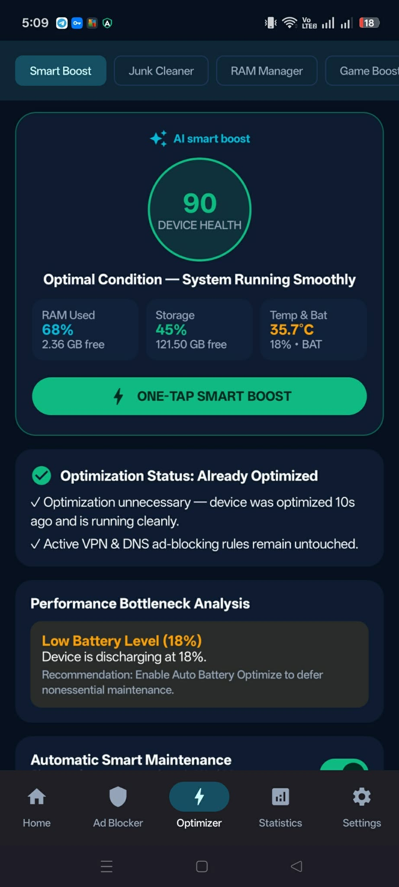
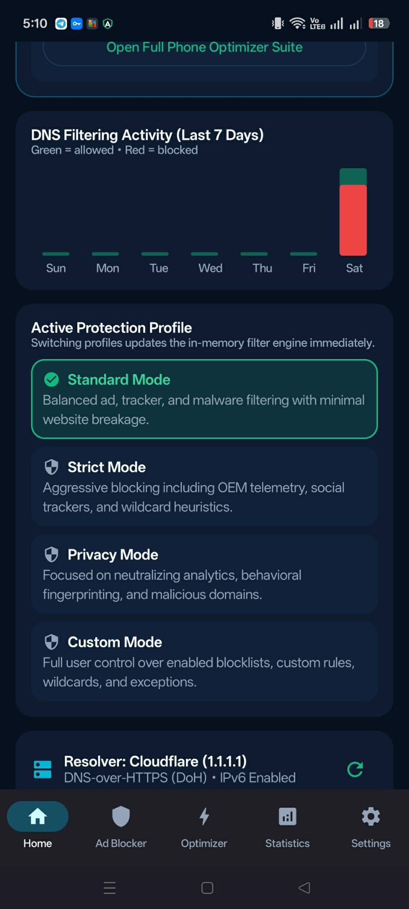
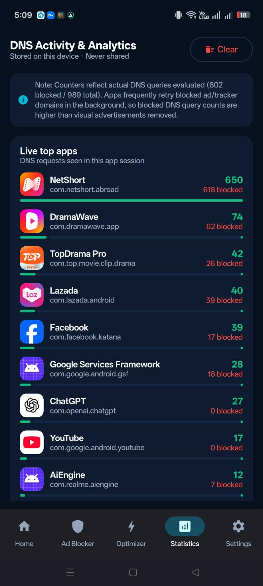
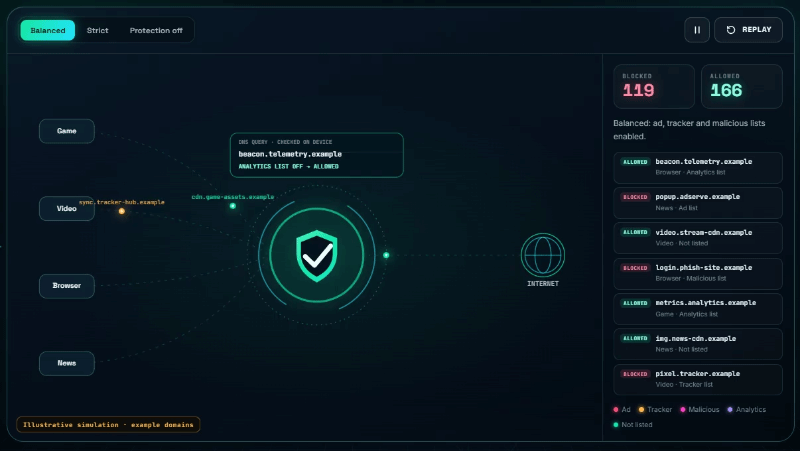

# AdShield Pro 2.2.5 — Android DNS Ad & Tracker Protection

AdShield Pro is a non-root Android app that filters DNS requests on-device and includes a built-in privacy browser and device-maintenance tools. It is built with Kotlin, Jetpack Compose (Material 3), Room, DataStore, WorkManager, Hilt, and Android `VpnService`.
## Website and downloads

- **Project website:** [https://adshieldpro-docs.vercel.app/](https://adshieldpro-docs.vercel.app/)
- **Direct APK download — v2.2.5:** [AdShield-Pro-2.2.5.apk](https://github.com/hillman3948-cyber/AdShieldPro/releases/download/v2.2.5/AdShield-Pro-2.2.5.apk)
- [Browse all GitHub releases](https://github.com/hillman3948-cyber/AdShieldPro/releases)

## App screenshots

<table>
  <tr>
    <td align="center"><br><strong>Home protection</strong></td>
    <td align="center"><br><strong>Smart Boost</strong></td>
  </tr>
  <tr>
    <td align="center"><br><strong>Activity and protection profiles</strong></td>
    <td align="center"><br><strong>DNS analytics and live top apps</strong></td>
  </tr>
</table>

## AdShield Pro in action



## What AdShield Pro does

- **Device-wide DNS filtering:** Run a local Android VPN service that routes DNS requests to AdShield's on-device filter. Other app traffic continues over the device's normal network connection; AdShield does not send it through a remote VPN server.
- **Choose protection modes:** Standard, Strict, Privacy, and Custom modes control which categories and lists are active. Strict mode can interfere with some apps or sign-ins.
- **Manage blocklists and rules:** Enable built-in ad, tracker, and threat lists; add custom HTTPS list sources; create custom block and allow rules; and review rule conflicts. Filter lists can sync in the background.
- **Use the built-in Privacy Browser:** Filter browser requests, remove common tracking query parameters, block pop-ups, manage third-party cookies, and apply cosmetic hiding rules inside this browser.
- **See activity and statistics:** View DNS totals, allowed and blocked queries, recent local activity, trends, and a live top-app view when Android provides app attribution for a DNS request.
- **Run AI Smart Boost:** Review memory, storage, battery, and temperature signals; safely clean eligible AdShield-owned temporary files; and optimize AdShield's own DNS cache and memory use. The “AI” feature name refers to local, rule-based analysis and recommendations; it does not call a cloud AI service. Android controls memory used by other apps, so Smart Boost does not promise to kill other apps or free their memory.
- **Clean storage with review controls:** Quick, deep, scheduled, and custom scans distinguish safe app-owned temporary files from downloads, duplicate files, and APK installers that require user review or confirmation. Android scoped-storage rules limit which shared files the app can inspect.
- **Use Game Booster and battery modes:** Select games and choose AdShield workload profiles that adjust its cache, background filter sync, and local logging behavior. Battery and thermal tools show device readings and can adapt AdShield's own background work; they do not override Android's system-wide power controls.
- **Check for app updates:** Check GitHub Releases from Home or receive a background update notification when Android runs scheduled work. The app downloads the signed APK and opens Android's installer; users approve installation themselves.
- **Keep settings on the device:** Settings, custom rules, and activity history are stored locally. Allowed DNS lookups are sent to the upstream DNS provider selected in the app, and that provider's privacy terms apply.

## Download and project links

- [Source code](https://github.com/hillman3948-cyber/AdShieldPro)
- [Latest releases and APK downloads](https://github.com/hillman3948-cyber/AdShieldPro/releases)
- [Privacy policy](https://github.com/hillman3948-cyber/AdShieldPro/blob/main/docs/PRIVACY_POLICY.md)
- [Report a problem](https://github.com/hillman3948-cyber/AdShieldPro/issues)

AdShield Pro is built with **Kotlin, Jetpack Compose (Material 3), Clean Architecture + MVVM, Room SQLite, DataStore, WorkManager, Hilt, and Android `VpnService`**. DNS filtering can reduce requests to known ad, tracking, and malicious domains, but it cannot guarantee protection from every threat.

---

## Technical architecture

### Layer 1 — Device-Wide Wire-Format DNS Engine (`engine/dns/`)
- **`DnsPacketCodec.kt`**: Full RFC 1035 / RFC 3596 wire-format DNS parser and response synthesizer. Supports IPv4 (`A`) and IPv6 (`AAAA`), `CNAME`, `HTTPS`, `SVCB`, `TXT`, and `MX` queries. Hardened against truncated headers and malicious cyclic compression pointer loops (`0xC0`).
- **`IpPacketFraming.kt`**: Full IPv4 and IPv6 packet parser and response builder supporting both **UDP (Port 53)** and **TCP (Port 53)** with RFC 1071 and RFC 8200 pseudo-header checksums.
- **`UpstreamDnsResolver.kt`**:
  - **DNS-over-HTTPS (DoH, RFC 8484)** via `application/dns-message` wireformat POST with bootstrap DNS resolution.
  - **DNS-over-TLS (DoT, RFC 7858)** over port 853 with TLS SNI and hostname certificate verification.
  - **Protected UDP & TCP Port 53** with automatic TCP upgrade on truncated (`TC=1`) responses.
  - **TTL-Aware LRU Cache** (`1024` entries) rewriting 2-byte Transaction IDs on cache hits for low-latency repeat lookups. When DoH or DoT fails, the resolver returns `SERVFAIL` instead of silently downgrading to plaintext; UDP/TCP is an explicit unencrypted mode.

### Layer 2 — High-Throughput Local VPN Service (`service/AdShieldVpnService.kt`)
- **DNS-Only TUN Routing**: Routes only virtual DNS server addresses (`10.215.173.2/32` and `fd00:ad5:1e1d::2/128`) into the TUN interface. Non-DNS application traffic flows directly over the physical network interface at native OS speed.
- **Loop Prevention**: Protects all upstream DoH, DoT, and UDP/TCP sockets via `VpnService.protect(socket)` and excludes `com.adshield.pro` from the tunnel.
- **Per-App Split Tunneling**: Supports per-app VPN exclusion via `VpnService.Builder.addDisallowedApplication()`.
- **Network Recovery & Boot Restoration**: Monitors Wi-Fi / Mobile Data transitions via `ConnectivityManager.NetworkCallback` and restores protection after device reboot via `BootCompletedReceiver`.

### Layer 3 — Privacy Browser Content & Cosmetic Blocker (`engine/browser/BrowserContentBlocker.kt`)
- Built-in Android `WebView` privacy browser (`ui/screens/BrowserScreen.kt`) with:
  - Subresource ad & tracker request interception (`shouldInterceptRequest`)
  - Cross-site tracking query parameter sanitizer (strips `fbclid`, `gclid`, `utm_*`, `msclkid`, `ttclid`, etc.)
  - Background pop-up blocker (`onCreateWindow`)
  - Cosmetic CSS + DOM element hiding for standard ad slots (`ins.adsbygoogle`, `[id^="div-gpt-ad"]`, `[data-ad-slot]`, etc.) plus custom CSS selectors
  - Per-website allowlist exceptions, third-party cookie blocking, and one-tap cookie/storage wipe.

### Layer 4 — Intelligent Lock-Free Filtering Rule Engine (`engine/filter/FilterRuleEngine.kt`)
- Uses an immutable `FilterSnapshot` inside an `AtomicReference` for lock-free microsecond lookups and zero-restart hot updates.
- Supports **Exact matching**, **$O(k)$ Subdomain suffix walk**, **Wildcard rules (`*`)**, and **Allowlist exceptions (`@@||domain^`)**.
- Strict priority evaluation:
  1. User Custom Allow Rules (`Priority 100`)
  2. User Custom Block Rules (`Priority 90`)
  3. System Safety Allowlist (`Priority 80`)
  4. Active Filter Lists filtered by `ProtectionMode` (`Standard`, `Strict`, `Privacy`, `Custom`) (`Priority 50`)
- Built-in **Duplicate & Conflict Analyzer** (`detectConflictsAndDuplicates`) and interactive **Live Domain Diagnostic Sandbox**.

### Layer 5 — Atomic Filter List Updater (`data/repository/AdShieldRepository.kt` & `worker/FilterUpdateWorker.kt`)
- Pre-configured with reputable filter sources (AdShield Core Bundled Baseline, AdGuard DNS Filter, OISD Small, HaGeZi Multi Light, URLHaus Malware Filter, StevenBlack Unified Hosts) + custom HTTPS filter URLs.
- Validates downloaded lists (rejecting HTML, scripts, or binary payloads), strips duplicates, writes atomically via `.tmp` and `.bak` files, and automatically rolls back on failure.

---

## 2. Technical Limitations & Honest Disclosures

1. **First-Party Multiplexed Streaming Ads:** Official YouTube, Facebook, TikTok, Instagram, and Twitch apps serve video/feed ads from the same first-party content delivery servers and TLS connections as legitimate videos. Blocking those domains via DNS would break video playback.
2. **Hardcoded Encrypted DNS Apps:** Apps that ignore Android system DNS and use proprietary internal DoH/QUIC resolvers bypass local DNS VPNs unless configured to use system DNS.
3. **External Third-Party Browser Cosmetic Filtering:** Due to Android process sandboxing, a standalone non-root app cannot inject cosmetic CSS into external third-party browsers; cosmetic DOM element hiding applies inside AdShield Pro's built-in Privacy Browser.

---

## 3. Project Structure

```text
PROJECT/
├── app/
│   ├── build.gradle.kts
│   ├── proguard-rules.pro
│   └── src/
│       ├── main/
│       │   ├── AndroidManifest.xml
│       │   ├── assets/default_blocklist.txt
│       │   └── java/com/adshield/pro/
│       │       ├── AdShieldApplication.kt
│       │       ├── MainActivity.kt
│       │       ├── data/
│       │       │   ├── local/db/ (Entities.kt, AdShieldDao.kt, AdShieldDatabase.kt)
│       │       │   ├── local/preferences/UserPreferencesRepository.kt
│       │       │   └── repository/AdShieldRepository.kt
│       │       ├── di/AppModule.kt
│       │       ├── domain/model/ (ProtectionModels.kt, RuleAndVpnModels.kt, StatsAndBillingModels.kt)
│       │       ├── engine/
│       │       │   ├── browser/BrowserContentBlocker.kt
│       │       │   ├── dns/ (DnsPacketCodec.kt, IpPacketFraming.kt, UpstreamDnsResolver.kt)
│       │       │   └── filter/FilterRuleEngine.kt
│       │       ├── service/ (AdShieldVpnService.kt, BootCompletedReceiver.kt)
│       │       ├── ui/
│       │       │   ├── screens/ (HomeScreen, ActivityScreen, FiltersScreen, RulesScreen, BrowserScreen, SettingsScreen)
│       │       │   ├── theme/Theme.kt
│       │       │   └── viewmodel/AdShieldViewModel.kt
│       │       └── worker/FilterUpdateWorker.kt
│       └── test/java/com/adshield/pro/AdShieldEngineTestSuite.kt
└── docs/
    ├── BUILD_AND_SIGNING_GUIDE.md
    ├── GOOGLE_PLAY_RELEASE_CHECKLIST.md
    └── PRIVACY_POLICY.md
```
